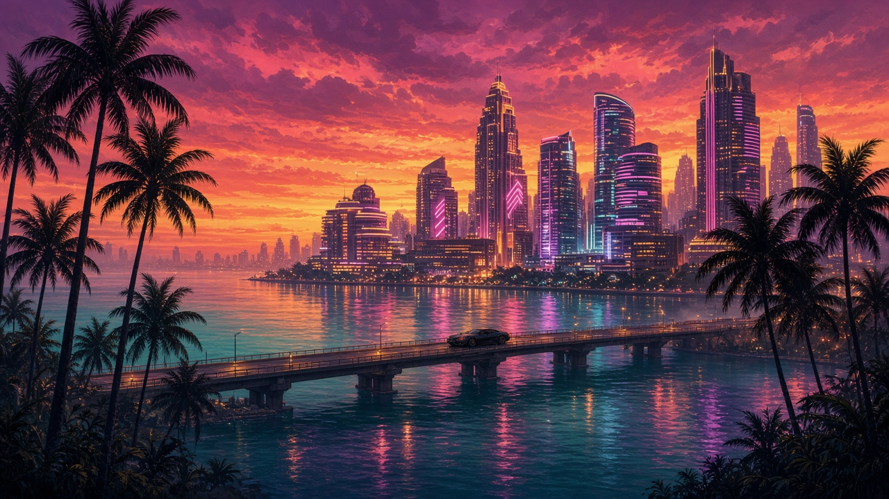
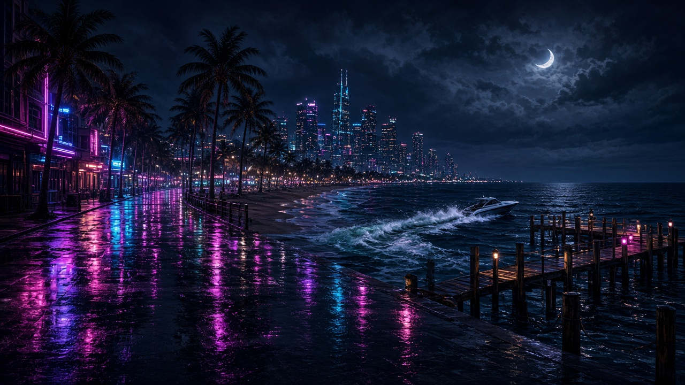
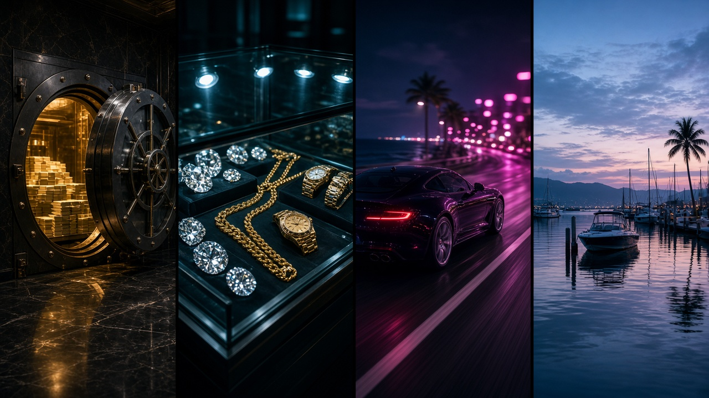

<p align="center">
  <strong>🗺️ Acceso al mapa:</strong> <a href="https://dablon.github.io/gta-vi-strategic-map/">https://dablon.github.io/gta-vi-strategic-map/</a>
</p>

<p align="center">
  
</p>

<h1 align="center">MAPA INTERACTIVO GTA VI LEONIDA HEIST ATLAS</h1>

<p align="center">
  <strong>Roba. Vende. Desaparece.</strong><br>
  Mapa interactivo de golpes, fences y salidas de Leonida para <em>GTA VI</em>.
</p>

<p align="center">
  <a href="https://dablon.github.io/gta-vi-strategic-map/">
    
  </a>
</p>

<p align="center">
  
  
  
  
</p>

<br>

<table>
  <tr>
    <td width="54%" valign="middle">
      
    </td>
    <td valign="top">
      <h3>El estado, en una pantalla</h3>
      <p>Vice City brilla. El pantano no perdona. Y el botín en la bolsa no paga hasta que alguien lo compra.</p>
      <p><strong>Leonida Heist Atlas</strong> marca dónde golpear, dónde convertir el loot en cash y por dónde salir cuando caen las estrellas. El mapa base es el de la comunidad <a href="https://map.gtadb.org">gtadb.org</a>. Encima van los pines de este proyecto: bóvedas, joyerías, stick-ups, fences, Pay ’n’ Spray, marinas y el calor de las comisarías.</p>
      <p>169 puntos. Zoom, pan y un panel que se comporta como un plano de golpe, no como una wiki.</p>
    </td>
  </tr>
</table>

## El ciclo del golpe



<table>
  <tr>
    <td width="25%" align="center"><strong>ROBOS</strong></td>
    <td width="25%" align="center"><strong>LIQUIDEZ</strong></td>
    <td width="25%" align="center"><strong>ESCAPE / HEAT</strong></td>
    <td width="25%" align="center"><strong>PREPARACIÓN</strong></td>
  </tr>
  <tr>
    <td>Bóvedas late-game ($65k–$205k), bancos, joyerías, payday loans, stick-ups, gasolineras, supermercados y compounds.</td>
    <td>Sin fence, el loot es peso muerto. Yasmani se queda las joyas y los billetes. Tyrone, los narcóticos.</td>
    <td>19 Pay ’n’ Spray, marinas, aeropuertos, tren y metro. Las comisarías van marcadas para que la ruta las esquive.</td>
    <td>Ammu-Nation, mod shops, safehouses y hospitales. Chaleco y coche antes del vault, no después.</td>
  </tr>
</table>

## Qué puedes hacer

| | |
|---|---|
| **Mapa** | Pantalla completa, zoom y pan con Leaflet. Mismos tiles de día; el modo Noche es un filtro encima. |
| **Panel** | Categorías agrupadas, con icono y contador. Mostrar todo, ocultar todo, buscar. |
| **Pin** | Popup con payout, seguridad, barrio y tip. Deep link copiable: `#id-del-pin`. |
| **Progreso** | Los visitados se guardan en `localStorage` y se pueden ocultar del mapa. |
| **Etiquetas** | Regiones a zoom bajo, barrios cuando te acercas. |
| **Filtros** | Región, nivel de seguridad y payout mínimo. |

### Presets de ruta

| Preset | Qué deja encendido |
|---|---|
| Bóvedas + escape | Vaults desde $65k, Pay ’n’ Spray, policía y marinas |
| Farm joyería → Yasmani | Joyerías, fences y respray |
| Compounds + narcóticos | Operaciones ilegales, fence y Ammu-Nation |
| Stick-ups low risk | Tiendas, gasolineras, supermercados y respray, solo seguridad baja |

## Regiones

| Región | Para qué sirve |
|---|---|
| Vice City | La densidad: bóvedas, joyerías y fences |
| Vice Beach | Lombank, Fleeca y Shorefront en Ocean Beach |
| Leonida Keys | Arranque de la historia. Stick-ups y Kingfishers |
| Grassrivers | Humedales. La salida es en airboat |
| Port Gellhorn | Pawn shops y Kolts & Associates |
| Ambrosia | Pueblo industrial, territorio biker |
| Belville / Waning Sands | Norte de Vice City |
| Capri | Costa del Golfo |
| Mount Kalaga | Norte forestal, rutas off-road |
| Hamlet | Prisión, M7, pawn y Pay ’n’ Spray |

## Precisión de los pines

| Borde | Significa |
|---|---|
| Sólido | Posición exacta de un landmark de gtadb |
| Punteado | Centroide del barrio. El sitio exacto todavía no está en el mapa de la comunidad |

Gasolineras, supermercados, aeropuertos, tren/metro, mod shops y hospitales salen de los landmarks de gtadb:

```bash
node scripts/extract-landmarks.mjs
```

Eso regenera `src/data/landmarkPins.ts`. No lo edites a mano.

## Correr en local

```bash
npm install
npm run dev
```

Abre [http://localhost:4731](http://localhost:4731).

```bash
npm run build    # tsc + Vite
npm run preview  # sirve el build
npm run lint     # oxlint
```

Cada push a `main` publica en GitHub Pages: [dablon.github.io/gta-vi-strategic-map](https://dablon.github.io/gta-vi-strategic-map/).

## Datos

- **Mapa y coordenadas.** Tiles `day` y landmarks de [gtadb.org](https://map.gtadb.org), licencia [CC BY 4.0](https://creativecommons.org/licenses/by/4.0/). Los tiles llegan por jsDelivr desde el repo [`rolux/gtadb.org`](https://github.com/rolux/gtadb.org). Este proyecto solo añade sus pines.
- **Payouts y tips.** Guías de la comunidad después del lanzamiento: PowerPyx, gta6activities, thegta6map, Mobalytics y sixthstar.
- **Pines nuevos.** `public/discovered.json` puede sumar ubicaciones encima del catálogo fijo, con fecha de última revisión en el pie del mapa.

## Aviso

Proyecto de fans para orientarte dentro del videojuego. Independiente de Rockstar Games y de Take-Two. Las tres ilustraciones de esta página son arte original: palmeras, neón y una lancha, no capturas ni material oficial. El mapa que abres en el atlas usa los tiles de gtadb.
